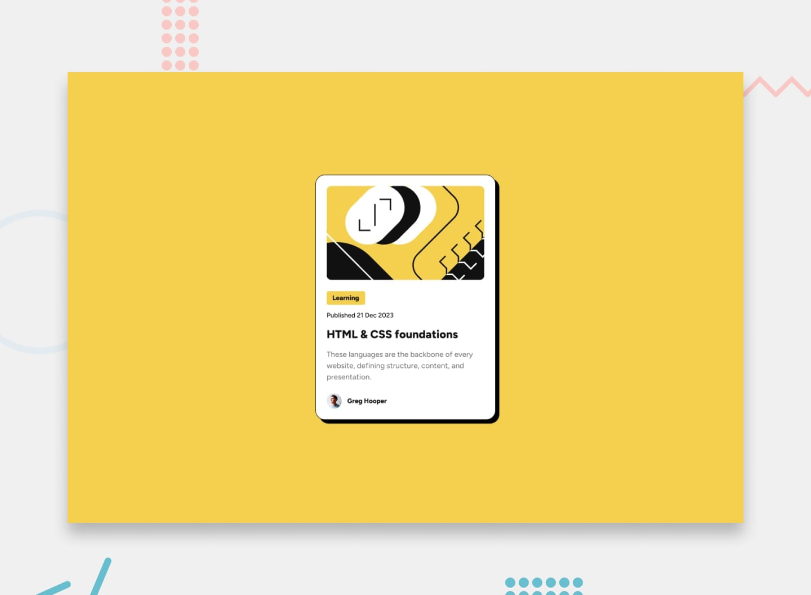

# Frontend Mentor — Blog Preview Card

This is my solution to the [Blog Preview Card challenge on Frontend Mentor](https://www.frontendmentor.io/challenges/blog-preview-card-ckPaj01IcS). I built it as a practical HTML and CSS exercise after completing the QR Code Component challenge.

## Table of contents

- [Overview](#overview)
  - [The challenge](#the-challenge)
  - [Design reference](#design-reference)
  - [Links](#links)
- [My process](#my-process)
  - [Built with](#built-with)
  - [What I learned](#what-i-learned)
  - [Continued development](#continued-development)
  - [Useful resources](#useful-resources)
  - [AI collaboration](#ai-collaboration)
- [Author](#author)

## Overview

### The challenge

Build a responsive blog article preview card based on the provided desktop and mobile designs, including the title's hover appearance and accessible interactive elements.

### Design reference



*This is the challenge's design preview, not a screenshot of my implementation. I plan to add a screenshot of my finished version separately.*

### Links

- [Frontend Mentor challenge](https://www.frontendmentor.io/challenges/blog-preview-card-ckPaj01IcS)
- **Live site:** [View the deployed Blog Preview Card](https://jeremiah-akpor.github.io/blog-preview-card/)
- **Frontend Mentor solution:** To be added after submission

## My process

### Built with

- Semantic HTML5 (`main`, `article`, `time`, and heading/link structure)
- CSS Flexbox
- Native CSS nesting
- Responsive styling with a media query
- CSS borders, border-radius, and box-shadow
- Locally hosted Figtree font files using `@font-face` (weights 500 and 800)

### What I learned

This challenge helped me strengthen my understanding of the difference between **semantic HTML** and **visual CSS styling**. For example, I kept the article title as a heading while controlling its appearance independently through CSS.

I also learned why a label can stretch across a flex column, and how `align-self: flex-start` makes just that item fit its contents:

```css
.card {
  display: flex;
  flex-direction: column;
}

.blog-tag {
  align-self: flex-start;
}
```

I practiced using a sharp offset shadow rather than a blurred one:

```css
.card {
  border: 1px solid black;
  box-shadow: 8px 8px 0 black;
}
```

Another useful lesson was giving the large cover illustration and the small author avatar **different sizing rules**, so one style does not accidentally affect both images.

Finally, I learned how to register different font-weight files under the same font family with `@font-face`.

### Continued development

I want to improve my ability to match reference designs more precisely, particularly typography, spacing, and responsive sizing. I also want to become more comfortable with keyboard focus states, choosing meaningful link destinations, and testing layouts across a wider range of screen sizes.

### Useful resources

- [MDN — HTML elements](https://developer.mozilla.org/en-US/docs/Web/HTML/Reference/Elements) — reference for semantic structure.
- [MDN — CSS Flexbox](https://developer.mozilla.org/en-US/docs/Web/CSS/CSS_flexible_box_layout) — understanding main/cross axes and item alignment.
- [MDN — box-shadow](https://developer.mozilla.org/en-US/docs/Web/CSS/box-shadow) — shadow offset and blur syntax.
- [MDN — @font-face](https://developer.mozilla.org/en-US/docs/Web/CSS/@font-face) — loading local font files.

### AI collaboration

I used ChatGPT as a learning partner to review my HTML and CSS, explain concepts I did not yet understand, and help debug issues such as shadow syntax, font weights, the stretching label, and avatar sizing.

I worked on implementing the challenge myself and used feedback to understand *why* changes were needed, rather than requesting a complete generated implementation.

## Author

- GitHub — [Jeremiah-Akpor](https://github.com/Jeremiah-Akpor)
